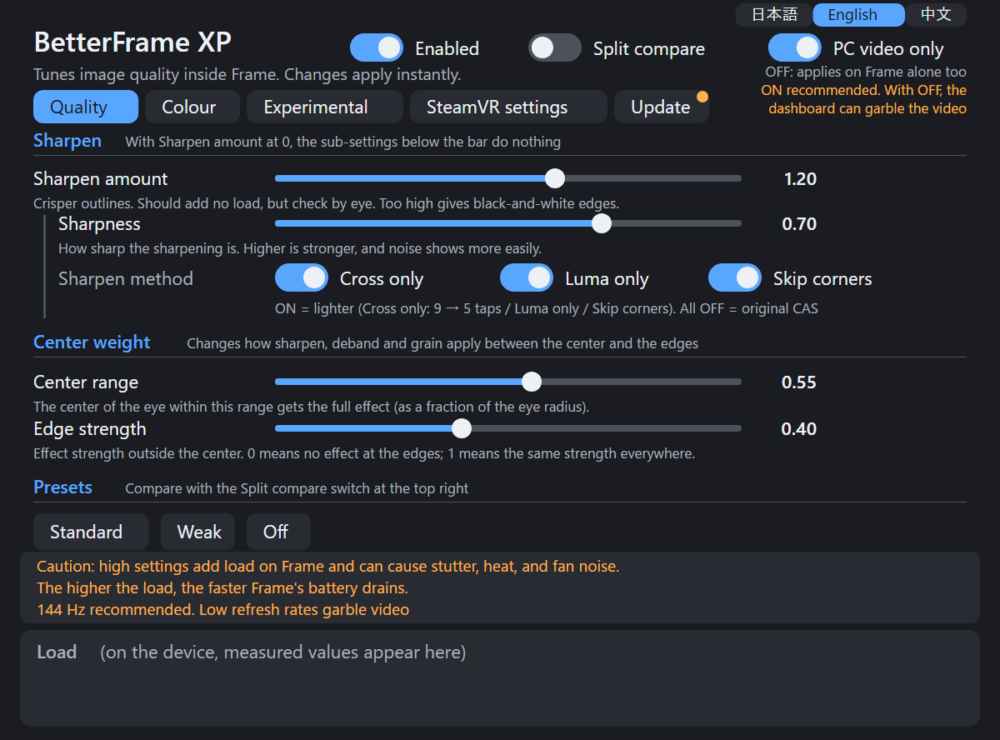
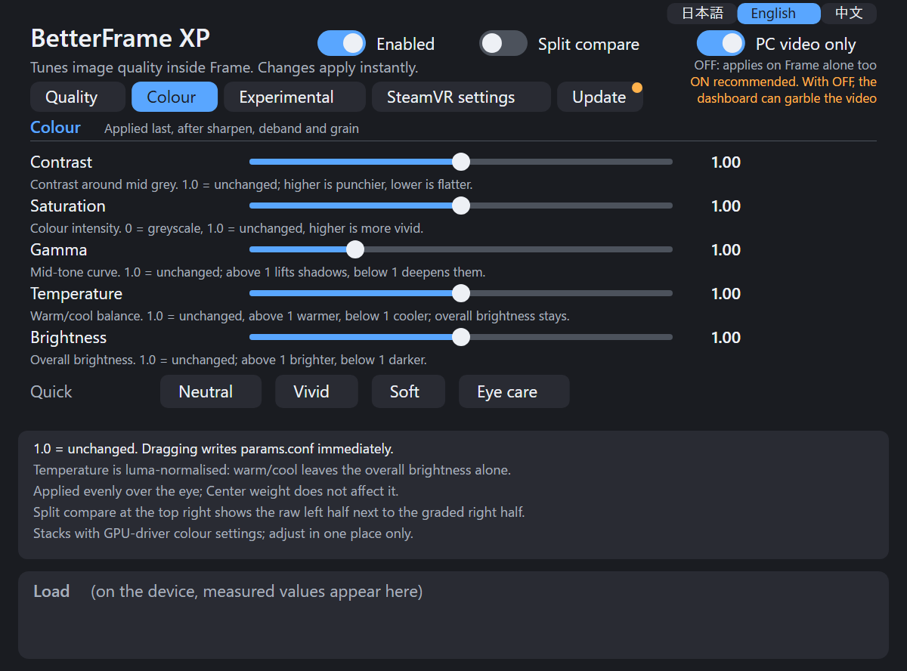
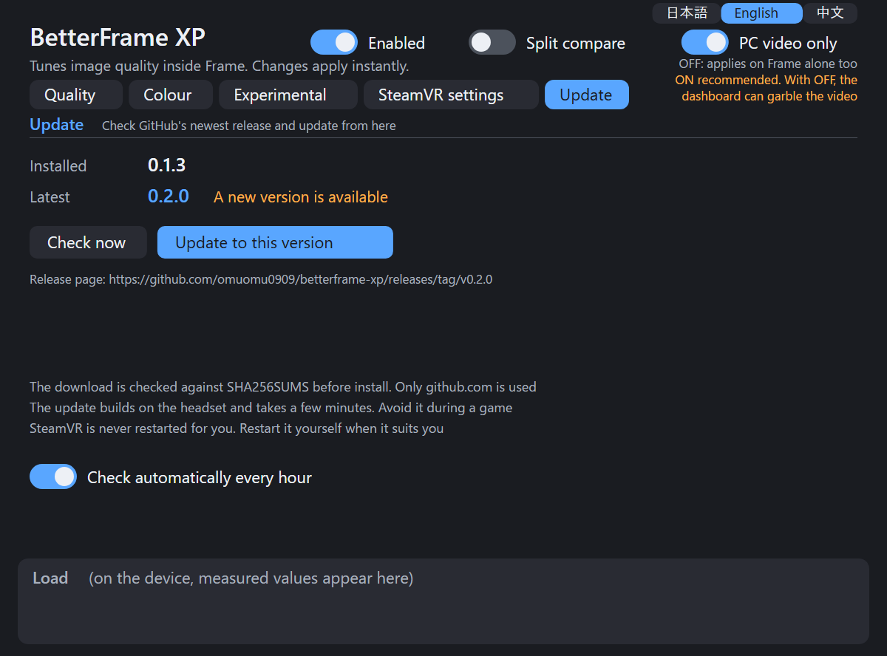
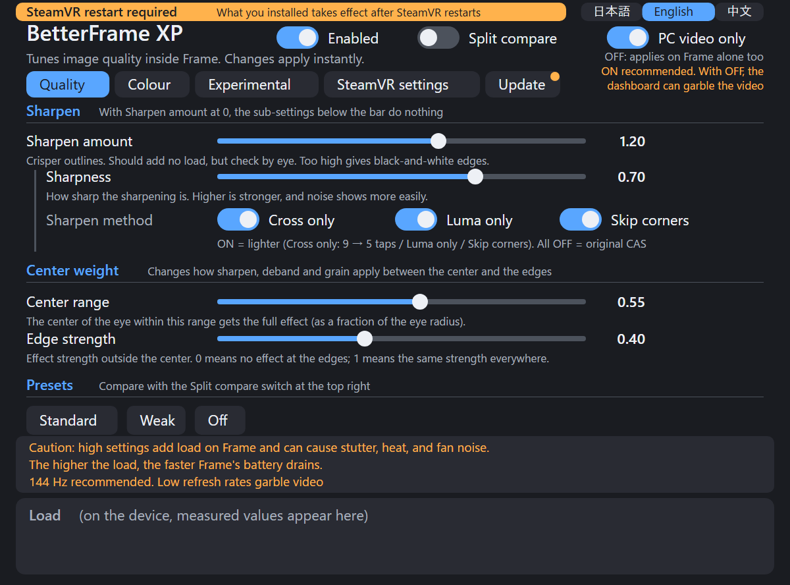

# BetterFrame XP

Japanese: [README.md](README.md) / Chinese: [README.zh.md](README.zh.md)

On Steam Frame, this applies AMD CAS sharpening on the Frame side to the video that the PC sends over Steam Link. It makes the slightly blurry wireless video sharper, and makes the "smeared like mud" look of grass and leaves in VRChat a little less noticeable.

> The docs under `docs/` are in Japanese for now.

> **Status: prototype.** Tested only on one author's Frame. The only effect confirmed so far is sharpening. It is built so it can be removed, but it is not guaranteed to work.

## Example of the effect

Photos the author took of the Frame's display (conditions: advanced supersampling off, resolution 250%, refresh rate 144 Hz).

| before | after |
|---|---|
|  |  |
|  |  |

These are from one author on one device, judged by eye. They are photos of a screen, so scan lines and moire show.

## Why on the Frame side

Over wireless, the video is compressed, and fine patterns are discarded first. Discarded detail cannot be recovered. If you sharpen on the PC, the emphasized detail takes encoder bits again. **If you apply it after decoding (on the Frame), it uses no extra bits.** For details, see the [guide](docs/GUIDE.md#映像が通る道pc--frame) (Japanese).

```
PC ─ encode ─ wireless ─▶ Frame: decode ─▶ compositor ─▶ ★sharpen here ─▶ display
```

## Install (one command on the Frame)

```sh
git clone https://github.com/omuomu0909/betterframe-xp.git && cd betterframe-xp
sh contrib/setup.sh
```

The script checks, builds (about a minute), installs, and enables. If something is missing, it stops without changing anything and tells you why. To check only, run `sh contrib/setup.sh --check`.

Then **restart SteamVR while you are not playing** (`setup.sh` does not restart it).

```sh
~/.local/bin/betterframectl status   # "loaded in vrcompositor" means success
```

On the PC side, turn **off** sharpening before encoding (`useSharpening`) in SteamVR. Running both applies it twice.

Requirements: Steam Frame (SteamOS, aarch64). Root is not needed. The build tools were already included in SteamOS 0.5.6. The dashboard panel is installed and enabled too. It needs a Japanese font (`noto-cjk` and similar); if that is missing, `setup.sh` stops. To skip the panel, use `--no-panel`. The panel is in Japanese by default; the "日本語 / English / 中文" buttons at its top right switch the language.

## Usage

Look of the panel (images made with `panel/tools/panel_preview.py --shots`):

| Quality | Colour | Update | Restart notice |
|---|---|---|---|
|  |  |  |  |

These are not screenshots from the device. They are mockups of the panel's HTML, with default values. The load field is where measured values appear on the device.

### Panel basics

- Adjust the look on the dashboard's "BetterFrame XP" panel while you watch it. Tabs: Quality / Colour / Experimental / SteamVR settings / Update.
- Switches at the top right: "Enabled" (turns sharpening and the rest on or off), "Split compare" (draws a line down the center of each eye; the left side is passed through, the right side is processed), and "PC video only" (ON recommended; with OFF, it is applied while Frame is on its own, too).
- The Quality tab has sharpness, center weight, and presets. The Colour tab grades the final picture (contrast / saturation / gamma / temperature / brightness, 1.0 = unchanged) after sharpening, with Neutral / Vivid / Soft / Eye care shortcuts. The Experimental tab is split into deband, sharpening assist, and grain. Sub-settings under the vertical line have no effect when that section's amount (sharpen, deband, or grain amount) is 0.
- Only the switches on the SteamVR settings tab change the SteamVR settings on the Frame itself. Each tab's Tips explain what each switch does.

### Closing the panel and opening it again

- When you do not need it, hover over the BetterFrame XP icon in the icon bar under the dashboard and press "Close". The panel program exits, and **"Enabled" turns OFF** (the `enabled` setting becomes 0, so sharpening and the rest pass through). This prevents the effect from staying on with no screen to control it. Other values do not change.
- The panel appears again at the next SteamVR start, but "Enabled" stays OFF, so turn it on yourself when you want to use it. To keep it from appearing at all, run `betterframectl panel-off`.
- To open it after closing, pick "BetterFrame XP" from the "+" button list on the dashboard. After it opens, turn "Enabled" on at the top right.

### From the command line

```sh
betterframectl set sharpenAmount 1.0   # sharpening amount (0 means none)
betterframectl off                     # pass through immediately
betterframectl on
```

### Checking that it works

Run `betterframectl set showSplit 1`. This draws a line down the center of each eye: the left side is passed through, and the right side is processed (the same as the panel's "Split compare").

### Raising the strength

- **Raising the strength should not raise the load, in theory.** The sharpening amount is used only in the final multiplication, so the pixels read and the amount of computation are the same. The load changes only between 0 and above 0. Changing the strength has not been measured.
- However, the author found that stronger settings tended to cause a sudden hitch. This **does not match the expectation from the formula, and it is unresolved**. If raising the strength adds hitches, lower it. See A-3 in [docs/STUTTER.md](docs/STUTTER.md) (Japanese).
- For what each value means, and **which effects can be said to be confirmed**, see the [settings reference](docs/SETTINGS.md) (Japanese). The docs separate what a change "should" do (predictions from formulas and code) from what the author **actually experienced** (one author, one Frame). When others try this, please treat the first as a guide.

### When "SteamVR restart required" appears

After you install or update, the layer (the video side) does not take effect until SteamVR restarts. An orange band at the top of the panel shows "SteamVR restart required". Restart while you are not playing. This tool does not restart SteamVR itself. The band disappears after a restart. Reinstalling only the panel does not show the band.

### Update

On the Update tab, the panel checks the latest GitHub release. If there is a newer one, "Update to this version" replaces the installed files. The downloaded file's SHA-256 is verified before it is installed. The replacement runs in a separate process and continues even if you close the panel. SteamVR is not restarted, so the change takes effect at the next SteamVR start. Automatic checks every hour can be turned off on the same tab. Only public GitHub releases can be checked; a private repository cannot be seen. To update by hand, run `git pull` and then `sh contrib/install.sh`.

## Recommended SteamVR settings

Settings that worked well on the author's one Frame (one person, one device; they may not suit everyone). The effect-example photos below were taken with advanced supersampling off, resolution 250%, and 144 Hz.

| Setting | Recommended | Where | Why |
|---|---|---|---|
| Advanced supersampling | Off | SteamVR on the PC | Off looked clearer and was lighter (the author's impression) |
| Resolution | 200–300% (author: 250%) | SteamVR on the PC | If the GPU has headroom, higher means less of the compression blur (the author's impression) |
| Refresh rate | 144 Hz (120 Hz is also fine) | SteamVR on the PC | At other rates, sharpening may cause hitches (see "Things to know" below) |
| Sharpening before encoding (`useSharpening`) | Off | SteamVR on the PC | It would stack with this tool's sharpening |
| Depth correction (gaze-aware reprojection) | OFF | The panel's "SteamVR settings" tab on the Frame | The change that reduced the wobble most on the author's setup. No downside noticed so far (one person, one device) |
| Eye position correction | OFF | Same | Stable with OFF together with depth correction (effect alone not verified). OFF matches Valve's default |

Other settings (target bitrate, streamed video width, and so on) have not been separated out enough to recommend.

## Revert

```sh
betterframectl disable     # do not load it from the next SteamVR start
betterframectl uninstall   # remove everything (with SteamVR running)
```

If SteamVR keeps failing to start, there is also a mechanism that removes the layer automatically. See the [guide](docs/GUIDE.md#起動に失敗したとき自動ガード) (Japanese).

## Things to know

> **Caution: if you raise the settings too high, the Frame's GPU load increases, and hitches (stutter) may occur.** As the load rises, the Frame's temperature rises too, and the fan may spin. **Battery drain also gets faster.** Watch the "Load" number (GPU ms) under the panel, and do not push the settings too far. For the types of stutter, see [docs/STUTTER.md](docs/STUTTER.md) (Japanese).

- **The current build has not been checked inside the headset.** It is at the stage of being checked after a SteamVR restart.
- **At refresh rates other than 144 Hz and 120 Hz, sharpening may cause hitches at regular intervals.** This was seen at 72 Hz and 80 Hz on the author's one Frame. The cause is not yet known. **Use 144 Hz or 120 Hz, or set `sharpenAmount` to 0 at other rates.** The author's notes say that turning sharpening off stopped the hitches. See section F of [docs/STUTTER.md](docs/STUTTER.md) (Japanese).
- The switches on the panel's "SteamVR settings" tab (depth correction and eye position correction) are the only ones that write to **SteamVR's settings** rather than to this layer. Nothing is written unless you press a switch. The original values are saved first, and `uninstall` restores them. In the author's environment, turning it off reduced the wobble. That is one person's impression on one device.
- Lost detail cannot be recreated. This is not super-resolution. Raising `sharpenAmount` above 1 tends to produce black-and-white outlines along edges.
- An OS or SteamVR update may break it.
- The Experimental tab (deband, grain, and so on) has not been evaluated enough visually.
- **Changing the deband amount can cause the video to break up.** This is also noted in the Experimental tab. If that happens, set `debandAmount` back to 0. The conditions and the cause have not been investigated yet.

## Terms

| Term | Meaning |
|---|---|
| CAS | AMD's sharpening (edge-emphasis) process. This tool applies it on the Frame side |
| Layer | A Vulkan layer: a component that puts a process on the image just before SteamVR's compositor (vrcompositor) shows it |
| vrcompositor | SteamVR's compositor. It builds the frames that are shown. This is what a SteamVR restart reloads |
| Deband | Smooths color steps (banding) such as in the sky (experimental) |
| Grain | Adds fine grain to the video so the flat look from compression is less noticeable (experimental) |
| `params.conf` | The settings file. The panel and `betterframectl set` rewrite it (`~/.config/betterframe-xp/`) |

## Further reading

All of these are in Japanese.

| Document | Contents |
|---|---|
| [docs/GUIDE.md](docs/GUIDE.md) | Detailed guide: the video path, a list of where files go, technical notes on each correction, how to revert, known issues |
| [docs/SETTINGS.md](docs/SETTINGS.md) | List of settings, and what has and has not been confirmed |
| [docs/STUTTER.md](docs/STUTTER.md) | Six kinds of "hitch", and which ones this tool does and does not affect. How to tell them apart when a hitch appears |
| [docs/ARCHITECTURE.md](docs/ARCHITECTURE.md) | Implementation notes: layer, video detection, measurement |
| [CHANGELOG.md](CHANGELOG.md) | Changes per version (Japanese) |
| [THIRD_PARTY.md](THIRD_PARTY.md) | Code this project is based on, and its licenses |

## License

MIT License ([LICENSE](LICENSE)). Copyright (c) 2026 omuomu0909.

Some of the code this project is based on is under other licenses. See [THIRD_PARTY.md](THIRD_PARTY.md) and the `LICENSE` in each directory. The layer is zlib, parts of the panel are MIT, the OpenVR headers are BSD-3-Clause, and CAS and deband are MIT.
