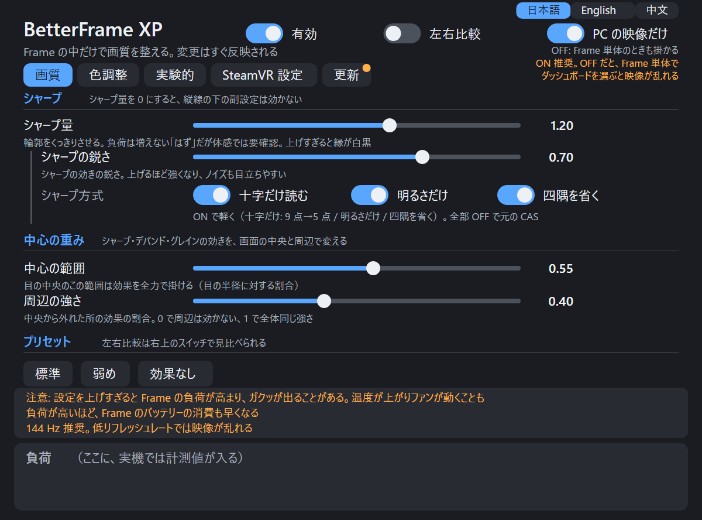
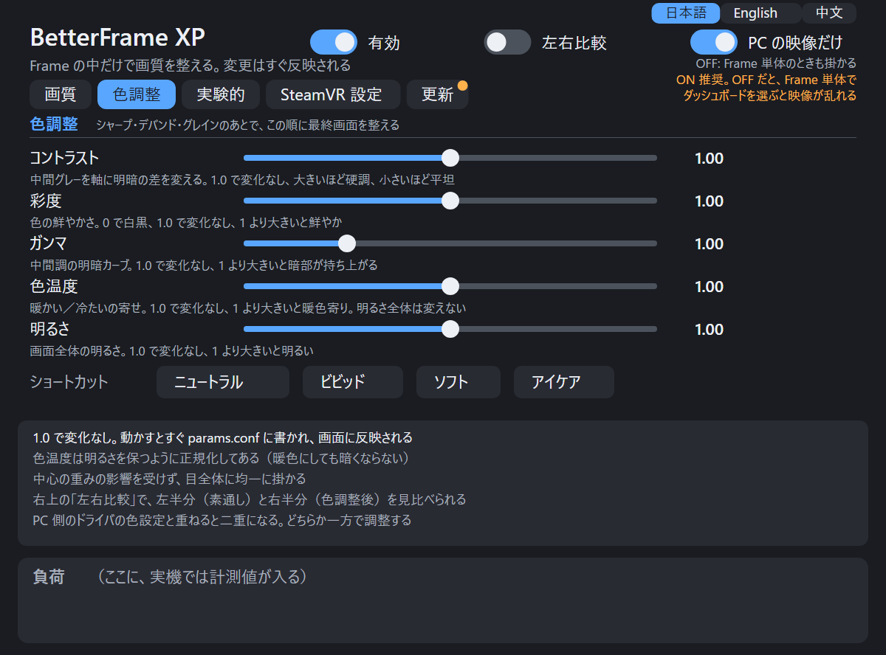
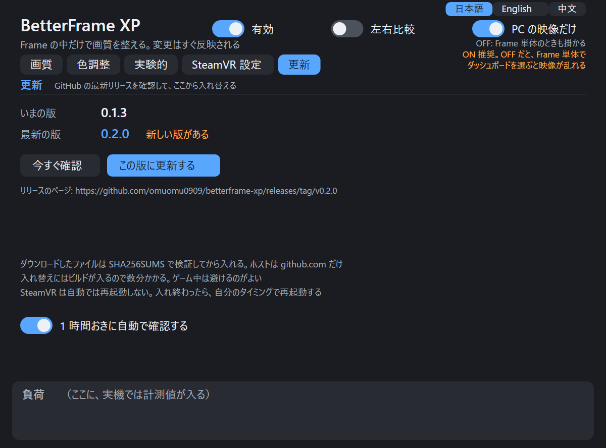
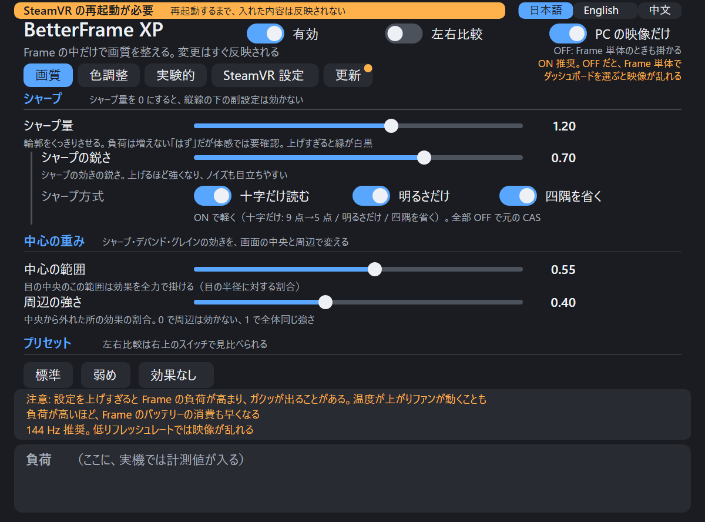

# BetterFrame XP

English: [README.en.md](README.en.md) / 中文: [README.zh.md](README.zh.md)

Steam Frame で、PC から Steam Link で送られてくる映像に**シャープ（AMD CAS）を Frame 側で後掛け**する。無線で少しぼやけた映像をくっきりさせ、VRChat の草や葉が「泥のように」つぶれるのを目立たなくするための道具。

> **状態: 試作。** 作者の Frame 1 台でしか確認していない。効果が確認できているのはシャープだけ。入れても戻せる作りにしてあるが、動作の保証はない。

## 効果の例

作者が Frame の画面を撮った写真（撮影条件: 高度なスーパーサンプリング オフ、解像度 250%、リフレッシュレート 144 Hz）。

| before | after |
|---|---|
|  |  |
|  |  |

写真は 1 人・1 台で、見た目の評価は作者の目による。画面を撮った写真なので、走査線やモアレが写っている。

## なぜ Frame 側なのか

無線では映像が圧縮されて、細かい模様が先に捨てられる。捨てられたものは戻せない。ただ、PC 側でシャープを掛けると、強調した細部がまた圧縮のビットを食う。**デコードしたあと（Frame 側）に掛ければ、ビットは使わない。** 詳しくは [ガイド](docs/GUIDE.md#映像が通る道pc--frame)。

```
PC ─ エンコード ─ 無線 ─▶ Frame: デコード ─▶ コンポジタ ─▶ ★ここでシャープ ─▶ ディスプレイ
```

## インストール（Frame 上で 1 コマンド）

```sh
git clone https://github.com/omuomu0909/betterframe-xp.git && cd betterframe-xp
sh contrib/setup.sh
```

確認 → ビルド（1 分ほど）→ 導入 → 有効化まで進む。足りないものがあれば、何も変えずに理由を出して止まる。まず確認だけなら `sh contrib/setup.sh --check`。

そのあと**遊んでいないときに SteamVR を再起動**する（`setup.sh` は再起動しない）。

```sh
~/.local/bin/betterframectl status   # "loaded in vrcompositor" と出れば成功
```

PC 側の SteamVR で、エンコード前のシャープ（`useSharpening`）は**切っておく**。両方掛けると二重になる。

必要なもの: Steam Frame（SteamOS、aarch64）。root 不要。ビルド道具は SteamOS 0.5.6 に最初から入っていた。ダッシュボードのパネルも一緒に入って有効になる（日本語フォント `noto-cjk` などが要る。足りなければ `setup.sh` が止まる。パネル不要なら `--no-panel`）。パネルは日本語が既定で、右上の「日本語 / English / 中文」で切り替えられる。

## 使い方

パネルの見た目（`panel/tools/panel_preview.py --shots` で作った画像）:

| 画質 | 色調整 | 更新 | 再起動の表示 |
|---|---|---|---|
|  |  |  |  |

画像は実機の画面ではなく、パネルの描き方を HTML に写した見本（数値は既定値、負荷の欄は実機で計測値が入る場所）。

### パネルの基本

- ダッシュボードの「BetterFrame XP」パネルで、掛け具合を見ながら変える。タブは「画質 / 色調整 / 実験的 / SteamVR 設定 / 更新」。
- 右上のスイッチ: 「有効」（シャープなど全体の ON/OFF）、「左右比較」（各目の中央に線を引く。左が素通し、右が処理後）、「PC の映像だけ」（ON 推奨。OFF だと Frame 単体のときも掛かる）。
- 画質タブは「シャープ」「中心の重み」「プリセット」。色調整タブは「コントラスト / 彩度 / ガンマ / 色温度 / 明るさ」で、シャープのあとで最終画面の色を整える（1.0 で変化なし）。ショートカットは「ニュートラル / ビビッド / ソフト / アイケア」。実験的タブは「デバンド」「シャープの補助」「グレイン」。縦線の下の副設定は、その段落の量（シャープ量・デバンド量・グレイン量）が 0 のときは効かない。
- 「SteamVR 設定」タブのスイッチだけが、Frame の SteamVR 自体の設定を書き換える。各スイッチの効果は、そのタブの Tips に書いてある。

### パネルを閉じる・もう一度出す

- 要らないときは、ダッシュボード下のアイコンバーで BetterFrame XP のアイコンにカーソルを合わせ、「閉じる」を押す。パネルのプログラムが終わり、**「有効」が OFF になる**（シャープなどは素通しになる。操作する画面が無いまま掛かりっぱなしになるのを防ぐため）。ほかの設定の値は変わらない。
- 次の SteamVR 起動でパネルはまた出るが、「有効」は OFF のまま。使うときは自分で ON にする。ずっと出したくなければ `betterframectl panel-off`。
- 閉じたあとで出したいときは、ダッシュボードの「＋」ボタンの一覧から「BetterFrame XP」を選ぶ。出したあと、右上の「有効」を ON にする。

### コマンドで操作する

```sh
betterframectl set sharpenAmount 1.0   # シャープの量（0 でなし）
betterframectl off                     # すぐ素通し
betterframectl on
```

### 効いているか確かめる

`betterframectl set showSplit 1` で各目の中央に線を引く。線の左は素通し、右は処理後なので、見比べられる（パネルの「左右比較」と同じ）。

### 強さを上げたとき

- **強さを上げても負荷は増えない「はず」**（シャープ量は最後の掛け算に使うだけで、読む画素も計算の量も同じ。負荷が変わるのは 0 か、0 より大きいかだけ。強さを変えての測定はしていない）。
- ただし作者の体感では「強めの設定ほどガクッとなりやすい」で、式のうえの予想と**食い違っている（未解決）**。強さを上げて引っかかりが増えたら下げてほしい。詳しくは [docs/STUTTER.md](docs/STUTTER.md) の A-3。
- 値の意味と、**どれが効いていると言えるか**は [設定リファレンス](docs/SETTINGS.md)。文書では、変えるとこうなる「**はず**」（計算式やコードから言える予想）と、「**作者が体感したこと**」（作者 1 人・Frame 1 台）を分けて書いてある。他の人が試すときは、前者を目安にしてほしい。

### 「SteamVR の再起動が必要」と出たら

入れたり更新したりしたあと、SteamVR を再起動するまで、レイヤー（映像側）の内容は反映されない。そのときパネルの上に橙色の帯が出るので、遊んでいないときに再起動する（このツールは再起動しない）。再起動すると帯は消える。パネルだけの入れ直しでは、帯は出ない。

### 更新

「更新」タブで、GitHub の最新リリースを確認し、新しければ「この版に更新する」で入れ替えられる。ダウンロードしたファイルは SHA-256 を確かめてから入れる。入れ替えは別のプロセスで動き、パネルを閉じても続く。SteamVR は再起動しない（反映は次の SteamVR 起動から）。1 時間ごとの自動確認は同じタブで切れる。GitHub の公開リリースだけを見る（非公開リポジトリは確認できない）。手動で更新するなら `git pull` して `sh contrib/install.sh`。

## おすすめの SteamVR 設定

作者の Frame 1 台で試して、よかった設定（1 人・1 台の体感。合うかは人による）。シャープの効果の例の写真は、高度なスーパーサンプリング オフ・解像度 250%・144 Hz で撮った。

| 設定 | おすすめ | どこで | 理由 |
|---|---|---|---|
| 高度なスーパーサンプリング | オフ | PC の SteamVR | オフのほうがはっきりして、軽かった（作者の体感） |
| 解像度 | 200〜300%（作者は 250%） | PC の SteamVR | GPU に余裕があれば、高いほうが圧縮でぼやっとする感覚が減る（作者の体感） |
| リフレッシュレート | 144 Hz（120 Hz も可） | PC の SteamVR | それ以外は、シャープを掛けると引っかかることがある（下の「知っておくこと」） |
| エンコード前のシャープ（`useSharpening`） | オフ | PC の SteamVR | このツールのシャープと二重になる |
| 奥行きの補正（視線認識型の再投影） | OFF | Frame のパネルの「SteamVR 設定」タブ | 作者の環境で、揺れを減らすのに一番効いた。困ったことは今のところ無い（1 人・1 台の体感） |
| 目の位置の補正 | OFF | 同上 | 奥行きと一緒に OFF にして安定した（単独の効果は未確認）。OFF は Valve の既定値と同じ |

これ以外の設定（目標ビットレート、送る映像の幅など）は、おすすめと言えるほど切り分けていない。

## 戻す

```sh
betterframectl disable     # 次の SteamVR 起動から読ませない
betterframectl uninstall   # 全部消す（SteamVR を起動した状態で）
```

SteamVR の起動に失敗が続いたら、自動でレイヤーを外す仕組みもある（[ガイド](docs/GUIDE.md#起動に失敗したとき自動ガード)）。

## 知っておくこと

> **注意: 設定を上げすぎると、Frame の GPU 負荷が高まり、ガクッが出る可能性があります。** 負荷が上がると Frame の温度も上がり、ファンが動くことがあります。**バッテリーの消費も早くなります。** パネルの下の「負荷」の数字（GPU ms）を見ながら、上げすぎないようにしてください。ガクッの種類は [docs/STUTTER.md](docs/STUTTER.md)。

- **今のビルドはヘッドセット内で未確認**（SteamVR の再起動後に確認する段階）。
- **画面を 144 Hz と 120 Hz 以外にすると、シャープを掛けているときに一定の間隔で引っかかることがある**（作者の Frame 1 台で、72 Hz と 80 Hz で確認。原因は未確定）。**144 Hz か 120 Hz で使うか、それ以外では `sharpenAmount` を 0 にしてほしい。** 作者の Frame では、シャープを切ると止まった。詳しくは [docs/STUTTER.md](docs/STUTTER.md) の F。
- パネルの「SteamVR 設定」タブ（奥行きの補正・目の位置の補正）だけは、このレイヤーではなく **SteamVR の設定**を書き換える。スイッチを押さなければ何も書かない。最初の値を控えてあり、`uninstall` が戻す。作者の環境ではオフのほうが揺れが減ったが、1 人・1 台の体感。
- 失われた細部は作れない（超解像ではない）。`sharpenAmount` を 1 より上げると縁に白黒の縁取りが出やすい。
- OS / SteamVR の更新で動かなくなる可能性がある。
- 「実験的」タブ（デバンド・グレインなど）は、見た目の評価がまだ十分ではない。
- **デバンド量を調整すると、映像が乱れる不具合がある**（パネルの実験的タブにも書いてある）。乱れたら `debandAmount` を 0 に戻す。条件や原因はまだ調べていない。

## 用語

| 言葉 | 意味 |
|---|---|
| CAS | AMD のシャープ（輪郭を強調する）処理。このツールが Frame 側で掛けるもの |
| レイヤー | Vulkan レイヤー。SteamVR の画面づくり（vrcompositor）が表示する直前に、画像へ処理を挟む部品 |
| vrcompositor | SteamVR のコンポジタ。表示するフレームを組み立てる。再起動の対象はここ |
| デバンド | 空などの色の段差（バンディング）をなめらかにする処理（実験的） |
| グレイン | 映像に細かい粒を乗せて、圧縮ののっぺり感を目立たなくする処理（実験的） |
| `params.conf` | 設定ファイル。パネルや `betterframectl set` が書き換える（`~/.config/betterframe-xp/`） |

## 読み物

| 文書 | 内容 |
|---|---|
| [docs/GUIDE.md](docs/GUIDE.md) | 詳しいガイド。映像の通り道、置き場所の一覧、各補正の技術説明、元に戻し方、既知の問題 |
| [docs/SETTINGS.md](docs/SETTINGS.md) | 設定の一覧と、確認できていること / できていないこと |
| [docs/STUTTER.md](docs/STUTTER.md) | 「ガクッ」の種類（6 種）と、このツールが関係するもの / しないもの。引っかかりが出たときの見分け方 |
| [docs/ARCHITECTURE.md](docs/ARCHITECTURE.md) | 実装の説明（レイヤー、映像の検出、計測） |
| [CHANGELOG.md](CHANGELOG.md) | 版ごとの変更 |
| [THIRD_PARTY.md](THIRD_PARTY.md) | 元にしたコードとライセンス |

## ライセンス

MIT License（[LICENSE](LICENSE)）。Copyright (c) 2026 omuomu0909。

元にしたコードは別のライセンスで、それぞれの表示は [THIRD_PARTY.md](THIRD_PARTY.md) と各ディレクトリの `LICENSE` にある（layer は zlib、パネルの一部は MIT、OpenVR ヘッダは BSD-3-Clause、CAS と deband は MIT）。
