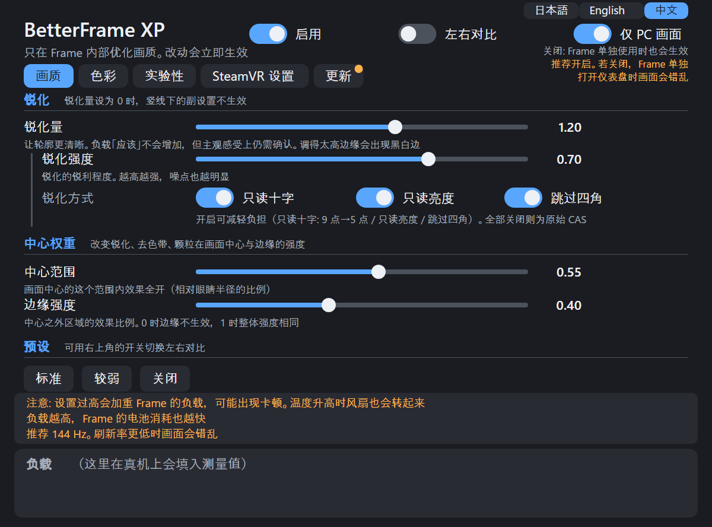
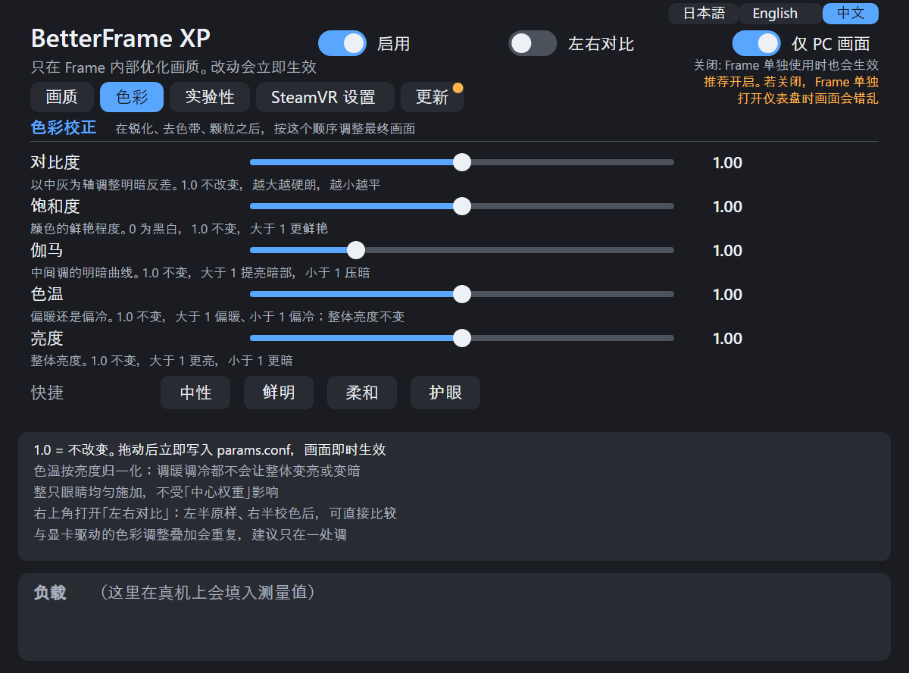
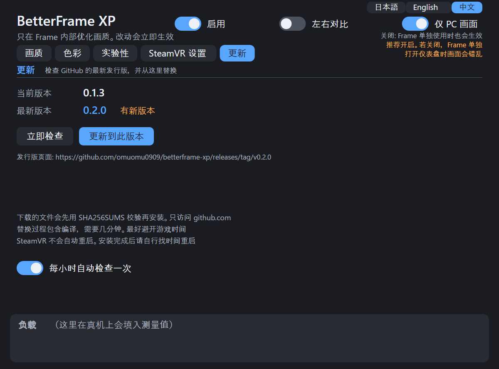
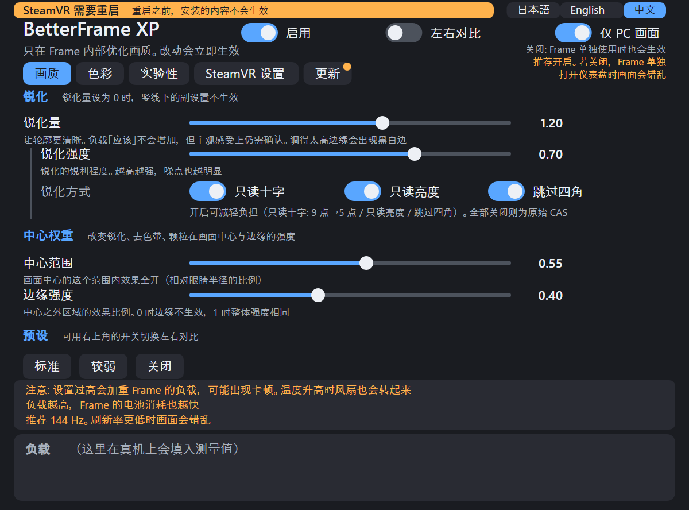

# BetterFrame XP

其他语言：日本語 → [README.md](README.md) / English → [README.en.md](README.en.md)

在 Steam Frame 上，把 PC 通过 Steam Link 送来的画面**在 Frame 侧做后期锐化（AMD CAS）**。这是一个让无线传输下略微模糊的画面变得清晰、让 VRChat 的草叶「像泥一样」糊掉的情况不那么显眼的工具。

> **状态：试验版。** 只在作者的 1 台 Frame 上确认过。确认有效果的只有锐化。虽然设计成装上之后也能还原，但不保证能正常工作。

## 效果示例

作者拍摄的 Frame 画面照片（拍摄条件：高级超级采样为关、分辨率 250%、刷新率 144 Hz）。

| before | after |
|---|---|
|  |  |
|  |  |

照片出自单人单机，观感评价凭作者的眼睛。因为是拍摄屏幕的照片，所以拍进了扫描线和摩尔纹。

## 为什么放在 Frame 侧

无线传输时画面会被压缩，细密的图案会最先被丢掉。丢掉的东西无法恢复。不过，如果在 PC 侧施加锐化，被强调的细节又会吃掉压缩的比特。**如果在解码之后（Frame 侧）施加，就不占用比特。** 详见[指南](docs/GUIDE.md#画面通路pc--frame)。

```
PC ─ 编码 ─ 无线 ─▶ Frame: 解码 ─▶ 合成器 ─▶ ★在这里锐化 ─▶ 显示器
```

## 安装（在 Frame 上用 1 条命令）

```sh
git clone https://github.com/omuomu0909/betterframe-xp.git && cd betterframe-xp
sh contrib/setup.sh
```

会依次进行确认 → 构建（约 1 分钟）→ 安装 → 启用。如果缺少什么，就不做任何改动、说出原因后停止。只想先检查的话，执行 `sh contrib/setup.sh --check`。

之后请在**不玩游戏的时候重启 SteamVR**（`setup.sh` 不会重启）。

```sh
~/.local/bin/betterframectl status   # 如果输出 "loaded in vrcompositor" 就表示成功
```

PC 侧的 SteamVR 里，编码前的锐化（`useSharpening`）请**保持关闭**。两边都施加就重复了。

需要的环境：Steam Frame（SteamOS、aarch64）。不需要 root。构建工具在 SteamOS 0.5.6 里本来就有。仪表盘的面板也会一起装上并启用（需要中日文字体 `noto-cjk` 等。缺少的话 `setup.sh` 会停止。不需要面板就加 `--no-panel`）。面板默认日文，可在右上角切换「日本語 / English / 中文」。

## 使用方法

面板的外观（用 `panel/tools/panel_preview.py --shots` 生成的图片）：

| 画质 | 色彩 | 更新 | 重启提示 |
|---|---|---|---|
|  |  |  |  |

这些图片不是真机画面，而是把面板的绘制方式照搬到 HTML 的样张（数值是默认值，负载一栏在真机上会填入实测值）。

### 面板基础

- 在仪表盘的「BetterFrame XP」面板里，一边看施加的强弱一边调整。标签页有「画质 / 色彩 / 实验性 / SteamVR 设置 / 更新」。
- 右上角的开关：「启用」（锐化等整体的 ON/OFF）、「左右对比」（在每只眼睛的中央画一条线。左边是直通，右边是处理后——锐化、去色带、颗粒和色彩校正都算在内）、「仅 PC 画面」（推荐 ON。OFF 的话 Frame 单独运行时也会施加）。
- 画质标签页是「锐化」「中心权重」「预设」。色彩标签页是「对比度 / 饱和度 / 伽马 / 色温 / 亮度」，在锐化之后对最终画面做一次色彩校正（1.0 = 不改变），另有「中性 / 鲜明 / 柔和 / 护眼」四个快捷值（护眼 = 偏暖、降低刺眼感）。实验性标签页是「去色带」「锐化辅助」「颗粒」。竖线下面的子设置，在对应段落的量（锐化量、去色带量、颗粒量）为 0 时不生效。
- 只有「SteamVR 设置」标签页的开关，改写的是 Frame 上 SteamVR 本身的设置。各开关的作用写在那个标签页的 Tips 里。

### 关闭面板、再次打开

- 不需要的时候，把光标移到仪表盘下方图标栏里的 BetterFrame XP 图标上，按「关闭」。面板程序结束，**「启用」变成 OFF**（锐化等变为直通。这是为了防止在没有可操作画面的情况下一直施加）。其他设置的数值不变。
- 下次启动 SteamVR 时面板还会出现，但「启用」仍是 OFF。要用的时候自己打开。如果一直不想让它出现，用 `betterframectl panel-off`。
- 关闭之后想再打开时，从仪表盘「＋」按钮的列表里选「BetterFrame XP」。打开之后，把右上角的「启用」打开。

### 用命令操作

```sh
betterframectl set sharpenAmount 1.0   # 锐化量（0 表示不施加）
betterframectl set contrast 1.1        # 对比度（1.0 表示不改变）
betterframectl off                     # 立即直通
betterframectl on
```

### 确认是否生效

用 `betterframectl set showSplit 1`，在每只眼睛的中央画一条线。线的左边完全直通，右边是处理后的结果（锐化、去色带、颗粒、色彩校正都只在右侧），所以可以对比（和面板的「左右对比」一样）。调色时也能这样确认差异。

### 提高强度时

- **提高强度也「应该」不会增加负载**（锐化量只用在最后的乘法上，读取的像素和计算量都一样。负载变化的只是 0 和大于 0 两种。没有做过改变强度的测量）。
- 但是在作者的主观感受里「设置越强越容易卡顿」，这和公式上的预期**不一致（未解决）**。提高强度后如果顿感增加，请降下来。详见 [docs/STUTTER.md](docs/STUTTER.md) 的 A-3。
- 各数值的含义以及**哪些可以说确实有效**，见[设置参考](docs/SETTINGS.md)。文档把「改变后会这样」的「**应该**」（从计算公式和代码能得出的预测）与「**作者实际感受到的**」（单人单机）分开写。别人试验时，请把前者当作参考。

### 出现「需要重启 SteamVR」时

安装或更新之后，在重启 SteamVR 之前，图层（Vulkan layer，画面一侧）的内容不会生效。这时面板上方会出现橙色条带，所以在不玩游戏的时候重启（这个工具不会重启）。重启后条带消失。只重装面板时，不会出现条带。

### 更新

在「更新」标签页里确认 GitHub 的最新发行版，如果有更新的版本，用「更新到这个版本」替换。下载的文件会先核对 SHA-256 再安装。替换在别的进程里进行，关闭面板也会继续。不会重启 SteamVR（从下次启动 SteamVR 开始生效）。每小时自动检查可以在同一个标签页里关掉。只看 GitHub 的公开发行版（非公开仓库无法检查）。手动更新的话，先 `git pull`，再执行 `sh contrib/install.sh`。

## 推荐的 SteamVR 设置

在作者的 1 台 Frame 上试过、觉得不错的设置（单人单机的主观感受。是否合适因人而异）。锐化效果示例的照片是在高级超级采样为关、分辨率 250%、144 Hz 下拍的。

| 设置 | 推荐 | 在哪里 | 理由 |
|---|---|---|---|
| 高级超级采样 | 关 | PC 的 SteamVR | 关掉更清晰，也更轻（作者的主观感受） |
| 分辨率 | 200〜300%（作者是 250%） | PC 的 SteamVR | 如果 GPU 有余量，越高压缩带来的模糊感越少（作者的主观感受） |
| 刷新率 | 144 Hz（120 Hz 也可以） | PC 的 SteamVR | 其他刷新率下施加锐化有时会卡顿（见下面「需要了解的事项」） |
| 编码前的锐化（`useSharpening`） | 关 | PC 的 SteamVR | 会与这个工具的锐化重复 |
| 景深校正（视线追踪重投影） | OFF | Frame 上面板的「SteamVR 设置」标签页 | 在作者的环境里，对减少摇晃最有效。目前没有遇到麻烦（单人单机的主观感受） |
| 眼位校正 | OFF | 同上 | 和景深一起设为 OFF 后稳定了（单独的效果未确认）。OFF 与 Valve 的默认值相同 |

除此之外的设置（目标比特率、传输画面的宽度等）还没有区分到可以推荐的程度。

## 还原

```sh
betterframectl disable     # 从下次启动 SteamVR 起不再加载
betterframectl uninstall   # 全部删除（在 SteamVR 启动的状态下）
```

如果 SteamVR 持续启动失败，还有自动摘掉图层的机制（[指南](docs/GUIDE.md#启动失败时自动保护)）。

## 需要了解的事项

> **注意：设置调得过高，Frame 的 GPU 负载会升高，可能出现卡顿。** 负载升高时 Frame 的温度也会升高，风扇可能会转。**电池消耗也会变快。** 请一边看面板下方的「负载」数值（GPU ms），一边注意不要调得过高。卡顿的种类见 [docs/STUTTER.md](docs/STUTTER.md)。

- **当前的构建还没有在头显内确认**（处于重启 SteamVR 后确认的阶段）。
- **把画面设成 144 Hz 和 120 Hz 以外时，施加锐化可能会以固定间隔出现卡顿**（在作者的 1 台 Frame 上，于 72 Hz 和 80 Hz 确认。原因未确定）。**请使用 144 Hz 或 120 Hz，其他刷新率下请把 `sharpenAmount` 设为 0。** 在作者的 Frame 上，关掉锐化就停止了。详见 [docs/STUTTER.md](docs/STUTTER.md) 的 F。
- 只有面板的「SteamVR 设置」标签页（景深校正、眼位校正）不是改写图层，而是改写 **SteamVR 的设置**。不按开关就什么都不写。最初的值已经记录下来，`uninstall` 会还原。在作者的环境里关掉后摇晃减少了，但这是单人单机的主观感受。
- 丢失的细节无法造出（这不是超分辨率）。把 `sharpenAmount` 提高到 1 以上，边缘容易出现黑白描边。
- OS / SteamVR 的更新可能让它无法运行。
- 「实验性」标签页（去色带、颗粒等）在外观上的评价还不充分。
- **调整去色带量会出现画面紊乱的问题**（面板的实验性标签页里也写了）。如果乱了，把 `debandAmount` 改回 0。条件和原因还没有调查。

## 术语

| 词语 | 含义 |
|---|---|
| CAS | AMD 的锐化（强调轮廓）处理。这个工具在 Frame 侧施加的 |
| 图层 | Vulkan 图层。在 SteamVR 的画面构建（vrcompositor）显示之前，把处理插入图像的部件 |
| vrcompositor | SteamVR 的合成器。组装要显示的帧。重启的对象就是它 |
| 去色带 | 让天空等处的色阶（条带）变平滑的处理（实验性） |
| 颗粒 | 在画面上叠加细小的颗粒，让压缩带来的平淡感不那么显眼的处理（实验性） |
| `params.conf` | 设置文件。面板和 `betterframectl set` 会改写它（`~/.config/betterframe-xp/`） |

## 延伸阅读

| 文档 | 内容 |
|---|---|
| [docs/GUIDE.md](docs/GUIDE.md) | 详细的指南。画面经过的路径、安装位置一览、各校正的技术说明、还原方法、已知问题 |
| [docs/SETTINGS.md](docs/SETTINGS.md) | 设置一览，以及已确认 / 未确认的事项 |
| [docs/STUTTER.md](docs/STUTTER.md) | 「卡顿」的种类（6 种），以及这个工具相关 / 无关的部分。出现卡顿时的分辨方法 |
| [docs/ARCHITECTURE.md](docs/ARCHITECTURE.md) | 实现的说明（图层、画面检测、测量） |
| [CHANGELOG.md](CHANGELOG.md) | 各版本的变更 |
| [THIRD_PARTY.md](THIRD_PARTY.md) | 所依据的代码与许可证 |

## 许可证

MIT License（[LICENSE](LICENSE)）。Copyright (c) 2026 omuomu0909。

所依据的代码采用其他许可证，各自的声明在 [THIRD_PARTY.md](THIRD_PARTY.md) 和各目录的 `LICENSE` 里（图层是 zlib，面板的一部分是 MIT，OpenVR 头文件是 BSD-3-Clause，CAS 与 deband 是 MIT）。
